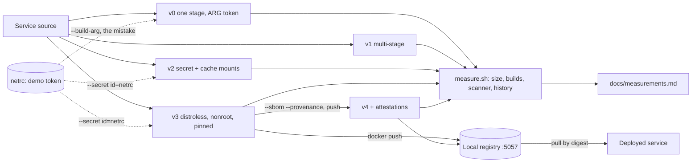

# Architecture: the image pipeline

This document describes what the code, Dockerfiles and scripts in this repository do and why they are shaped this way. Component names match the lesson ("a compiled service, a local registry, five image versions"): the **service**, the **one-stage image v0**, the **multi-stage image v1**, **v2** with mounts, **v3** distroless and non-root, **v4** with an SBOM and provenance, and the **local registry**.

## Components and what each owns

| Component | Where it lives | What it owns |
| --- | --- | --- |
| **Service** | [`cmd/svc`](cmd/svc), [`internal`](internal) | A small Go HTTP service: `GET /health` answers `ok`, `GET /version` answers the build's version, commit and Go version as JSON, and `svc healthcheck` checks a running instance (the container's health command). Graceful shutdown on SIGTERM and SIGINT. |
| **v0: one stage** | [`build/history/v0.Dockerfile`](build/history/v0.Dockerfile) | The starting point: the full SDK image, the token as a build argument, the source and the compiler all in the shipped image. |
| **v1: multi-stage** | [`build/history/v1.Dockerfile`](build/history/v1.Dockerfile) | Compile in a build stage, ship a static binary on a slim Debian. |
| **v2: secret and cache mounts** | [`build/history/v2.Dockerfile`](build/history/v2.Dockerfile) | The token as a BuildKit secret mount, module and compiler caches as cache mounts. |
| **v3: distroless, non-root, pinned** | [`Dockerfile`](Dockerfile) | The shipped image: static binary on `distroless/static-debian12:nonroot`, both bases pinned by digest, `USER nonroot:nonroot`, a self-checking `HEALTHCHECK`. |
| **v4: SBOM and provenance** | `make sbom` ([`scripts/sbom.sh`](scripts/sbom.sh)) | The v3 Dockerfile built with `--sbom=true --provenance=mode=max` and pushed to the registry; the attestations are stored beside the image. |
| **Local registry** | service `registry` in [`docker-compose.yml`](docker-compose.yml), `registry:2` pinned by digest | Pushes, pulls and digests without an account anywhere. Listens on `127.0.0.1:5057`. |
| **Builder** | `shrink-and-harden`, a `docker-container` BuildKit builder with host networking ([`Makefile`](Makefile) target `builder`) | An isolated build cache, so a cold build is really cold and the measurements do not depend on what else is on the machine; the only driver that can attach an SBOM and provenance and push to a `localhost` registry. |
| **Measurements** | [`scripts/measure.sh`](scripts/measure.sh), [`docs/measurements.md`](docs/measurements.md) | Size, cold build, warm build, scanner counts and token lines in the history for every version. |
| **Done-when checks** | [`tests/e2e`](tests/e2e) | One script per Done-when line, run against real images. |

## Pattern: layers inside a small service, and a history of Dockerfiles

The service is deliberately small, but it follows the same layering as the other repositories: `domain` (the status and the build information), `application` (a `Service` with a `BuildInfoSource` port), `infrastructure` (configuration from the environment, build information, logging), `interfaces` (HTTP with graceful shutdown, the health command), and `cmd/svc` as the composition root. A Go test (`internal/architecture_test.go`) parses the imports and fails when a layer imports one above it or when `domain` or `application` import anything outside the standard library. The image history is kept as Dockerfiles in the tree rather than as build arguments ([ADR 0001](docs/adr/0001-pipeline-stages-as-separate-dockerfiles.md)).

## Data flow

### One pass of the pipeline (`make run`, then `make sbom`)

1. `make up` copies `netrc.example` to `netrc` (a made-up token for a pretend private package server; nothing in this project contacts that host) and starts the registry, waiting until its health check passes.
2. `scripts/deploy.sh` builds the root `Dockerfile` with `docker build --secret id=netrc,src=./netrc`. In the build stage `go mod download` runs with the netrc mounted at `/root/.netrc` for that one command; `go build` runs with `CGO_ENABLED=0 -trimpath` and the version stamped by `-ldflags`. The final stage copies only `/out/app` onto the distroless base.
3. `docker push localhost:5057/svc:v3` prints the manifest digest. The script reads it from the output.
4. `docker compose --profile deploy up --wait svc` runs the image as `localhost:5057/svc@sha256:...`: read-only, no capabilities, 64 MB, the image's own health check passing.
5. `curl /health` answers `ok`; `curl /version` answers the stamped version. If someone later pushes a different image under the tag `v3`, this deployment still names the first digest and does not change.
6. `make sbom` builds the same Dockerfile on the dedicated builder with the attestations and pushes `svc:v4`. `docker buildx imagetools inspect ... --format '{{ json .SBOM }}'` lists the packages inside; `.Provenance` says how and where it was built.

## Decisions and trade-offs

- **Dockerfiles as history** ([ADR 0001](docs/adr/0001-pipeline-stages-as-separate-dockerfiles.md)): any version can be rebuilt and measured; the cost is that the base digests are repeated.
- **Distroless static and a self-checking binary** ([ADR 0002](docs/adr/0002-distroless-static-and-a-self-checking-binary.md)): no shell, no package manager, one process; the health check and the debugging plan replace what the shell gave.
- **Secret mounts and cache mounts** ([ADR 0003](docs/adr/0003-build-secrets-and-cache-mounts.md)): the token never reaches a layer; the module and compiler caches never reach the image.
- **Digests everywhere** ([ADR 0004](docs/adr/0004-pin-by-digest-and-deploy-by-digest.md)): bases are pinned by digest, and the deployment names the image by digest, so a moved tag cannot change what runs.
- **Standard library only.** The service has no third-party module, which is also what the lesson's service has. Consequence: the module cache mount has nothing to cache here and the warm-build speedup comes from the compiler cache and the layer order; the mount is kept because a first dependency makes it matter, and the Dockerfile should not change when that happens.
- **Tooling in containers.** There is no Go on the machine: `make test`, `make lint` and `make audit` run pinned images (`golang`, `golangci-lint`, `hadolint`, `shellcheck`). The cost is the first-pull time; the benefit is that a fresh clone needs only Docker and Make.

## Failure modes the lesson teaches, and how the code shows them

| Mistake | Where it shows |
| --- | --- |
| The token passed as `--build-arg`: stored in the history for ever | `docker history --no-trunc svc:v0 \| grep demo-token` prints the `RUN` line with the token; `tests/e2e/01_token_leak_and_secret_mount.sh` asserts it, and asserts its absence for v2 and v3 |
| Copying the whole build stage into the final stage | would put the compiler back; `tests/e2e/02_multistage_size_and_smoke.sh` asserts v1 is under a quarter of v0 |
| A dynamic binary on a base without a C library | `CGO_ENABLED=0` in v1 to v3; a binary built without it fails to start on distroless with "no such file or directory" |
| Cache mount used for a secret, or the reverse | the Dockerfile uses `--mount=type=secret` for the token and `--mount=type=cache` for the caches, each on its own `RUN` option |
| "Pinned" by tag | `tests/e2e/05_digest_pinning.sh` moves a tag and shows the digest deploy does not change |
| A no-shell base with no debugging plan | [README](README.md) and [ADR 0002](docs/adr/0002-distroless-static-and-a-self-checking-binary.md) list the order to try |

## Limits of the teaching build against a production one

- The registry is local, unauthenticated and plain HTTP on loopback. A real one needs TLS, authentication and garbage collection.
- The image is not signed and the signature is not verified before running; that is the lesson's stretch goal.
- Single platform (the machine's own). A multi-platform manifest is a stretch goal.
- The scanner is Trivy with its default database; counts change daily as the database does, so the table's absolute numbers age. The ratios and the order do not.
- The private package server is imaginary. The secret mount is exercised, but no request carries the token.

## How to extend it

- **A real dependency:** add it to `go.mod`, commit `go.sum` (and change `COPY go.mod ./` to `COPY go.mod go.sum ./`); the module cache mount starts paying off at once. Re-run `make measure`.
- **Multi-platform:** `docker buildx build --platform linux/amd64,linux/arm64 --push` on the same builder; `CGO_ENABLED=0` already makes the binary portable.
- **Signing:** add `cosign sign` after the push and a `cosign verify` before `docker run`; keep the digest as the identity.
- **A CI gate on new critical findings:** run `trivy image --severity CRITICAL --exit-code 1` against the runtime image after the build.
